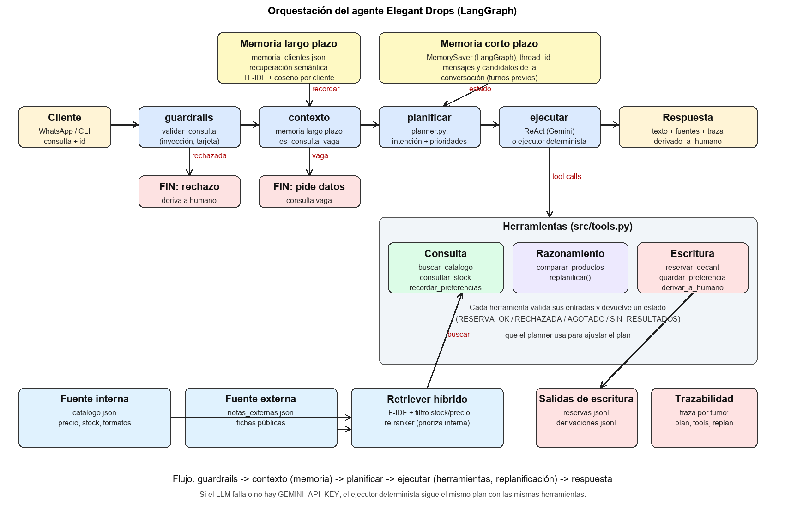

# Agente Elegant Drops: observabilidad y trazabilidad (EP3)

Agente conversacional para **Elegant Drops** (decants de perfumes, elegantdrops.cl).
Evaluación Parcial N°3 de Ingeniería de Soluciones con IA (ISY1010, Duoc UC): instrumenta el
agente de la EP2 (herramientas, memoria y planificación) con métricas, logs, trazas, dashboard
y controles de seguridad.

- **Integrantes:** Diego Miranda · Lucas Alcaino
- **Informe:** `docs/informe_ep3.docx` · **Presentación:** `docs/presentacion_ep3.pptx`
- **Evidencia:** `docs/evidencia_pruebas.txt`, `docs/capturas/`, `data/evaluacion/`

## Instalación

Probado con Python 3.14 en Windows.

```bash
git clone https://github.com/E1egant/Rag-Soluciones-Con-Ia.git
cd Rag-Soluciones-Con-Ia
python -m venv .venv
.venv\Scripts\activate          # Linux/Mac: source .venv/bin/activate
pip install -r requirements.txt
cp .env.example .env            # opcional: GEMINI_API_KEY (https://aistudio.google.com/app/apikey)
```

Todo funciona **sin clave** (ejecutor determinista). Con `GEMINI_API_KEY` el LLM usa las herramientas.

## Cómo ejecutar y validar

| Qué | Comando |
|---|---|
| Pruebas (42) | `python -m pytest tests/ -v` |
| Dashboard | `streamlit run dashboard.py` → http://localhost:8501 |
| Chat (genera registros "en vivo") | `python main.py` |
| Un turno | `python main.py "quiero reservar Born In Roma 5ml" ana` |
| Evaluación | `python -m src.evaluacion --etiqueta mejorado` |
| Validación independiente | `python -m src.evaluacion --etiqueta holdout --repeticiones 3 --escenarios data/escenarios_holdout.json` |
| Evaluación con LLM | `python -m src.evaluacion --etiqueta llm --llm --repeticiones 1 --ids n01 n02 t01` |
| Análisis de logs | `python -m src.analisis data/evaluacion/llm/logs.jsonl` |
| Borrar memoria de un cliente | `python main.py --olvidar ana` |

Cada evaluación **sobrescribe** `data/evaluacion/<etiqueta>/`. No reutilizar la etiqueta `base`:
es la línea base medida antes de las correcciones y con el código actual no se puede regenerar.
La versión con LLM depende de la disponibilidad y cuota de Google.

## Arquitectura



Grafo LangGraph (`src/agente.py`): `guardrails → contexto → planificar → ejecutar`.

```
turno del cliente ─► agente (traza: trace_id)
                      ├─ nodo:guardrails / contexto / planificar
                      └─ nodo:ejecutar
                           ├─ llm:<modelo>           (tokens, errores)
                           ├─ evento:fallback_llm
                           └─ herramienta:<nombre> ─► retriever:tfidf.buscar
        spans JSON redactados ─► logs JSONL ─► src/analisis.py ─► dashboard.py
```

| Archivo | Rol |
|---|---|
| `src/observabilidad.py` | Logs JSON y trazas (`session_id`, `trace_id`, `span_id`, `parent_span_id`), tokens, CPU, memoria |
| `src/evaluacion.py` | Precisión, consistencia, errores, latencia y recursos sobre casos etiquetados |
| `src/analisis.py` | Cuellos de botella, errores, bucles y latencias atípicas |
| `dashboard.py` | Indicadores, alertas, latencia, errores, trazas, antes/después y registros en vivo |
| `src/seguridad.py` | Redacción de PII y seudonimización |
| `src/normalizacion.py` | Tipeo, sinónimos, género y detección de productos nombrados |
| `src/agente.py`, `tools.py`, `planner.py`, `memoria.py` | Agente de la EP2, con las correcciones |

## Resultados (modo determinista, 33 casos × 5 repeticiones)

| Métrica | Línea base | Mejorado |
|---|---|---|
| Precisión | 60,6 % | 97,0 % |
| Consistencia entre repeticiones | 100 % | 100 % |
| Ataques bloqueados | 33,3 % | 100 % |
| Hallazgos de PII persistida | 5 | 0 |

**Validación independiente** (12 casos no usados para corregir): precisión **66,7 %**, 50 % de ataques
bloqueados. El 97 % se midió sobre los casos que guiaron las correcciones y sobrestima la generalización.

Hallazgos y correcciones: ver sección 3 del informe. Con LLM real aparecieron errores 504 en
`gemini-3.6-flash`, un 503 y un 429 en el modelo de respaldo; el agente degrada al ejecutor determinista.
La corrida `data/evaluacion/llm` usó `gemini-3.1-flash-lite`; `llm_t02` reverifica la corrección de la
respuesta sobre productos agotados (el caso figura fallido porque el criterio exige una frase literal).

## Configuración

| Variable | Uso | Por defecto |
|---|---|---|
| `GEMINI_API_KEY` | activa el LLM | — |
| `GEMINI_MODEL` / `GEMINI_MODEL_RESPALDO` | modelo principal y de respaldo | `gemini-3.6-flash` / `gemini-3.1-flash-lite` |
| `LLM_TIMEOUT_S` | espera máxima por llamada | 20 |
| `LOG_SALT` | sal de los seudónimos (obligatoria en producción) | valor de desarrollo |
| `PRECIO_USD_MTOK_ENTRADA` / `_SALIDA` | cálculo de costo | 0 |

Si el modelo principal responde 504, definir `GEMINI_MODEL=gemini-3.1-flash-lite`.

## Seguridad y privacidad

- La PII (correo, teléfono, RUT, tarjeta) se redacta antes de memoria, historial, logs y LLM.
- Los logs usan seudónimos HMAC; `data/logs/`, reservas, derivaciones y memoria no se versionan.
- Solo se reserva un producto que el cliente nombró o aludió, validando stock y formato.
- Guardrail contra inyección, timeout, límite de recursión y cortacircuito del LLM.
- Pendiente: cifrado, retención, límite de tasa y supresión en logs y reservas.

## Limitaciones

- Catálogo de 5 productos y 3 fichas.
- Recuperación léxica (TF-IDF + alias): falla ante expresiones nuevas e inglés.
- El guardrail por patrones no cubre todas las paráfrasis.
- La corrida con LLM es pequeña (11 turnos, 1 repetición).
- Las reservas quedan en archivo; no descuentan stock ni cobran.
- `create_react_agent` está deprecado en LangGraph 1.x.

Los documentos de la EP2 (`docs/informe_ep2.docx`, `docs/presentacion_ep2.pptx`) se conservan.

## Uso de IA

Se usó Claude Code (Anthropic) para código, pruebas, escenarios, mediciones y borrador descriptivo del
informe y la presentación. Las conclusiones, justificaciones técnicas y reflexiones individuales las
redacta el equipo (https://bibliotecas.duoc.cl/ia).

## Referencias

- LangChain, Inc. (2025). *LangGraph documentation*. https://langchain-ai.github.io/langgraph/
- OpenTelemetry Authors. (2025). *OpenTelemetry documentation*. https://opentelemetry.io/docs/
- OWASP Foundation. (2025). *OWASP top 10 for LLM applications 2025*. https://genai.owasp.org/llm-top-10/
- Streamlit. (2025). *Streamlit documentation*. https://docs.streamlit.io/
